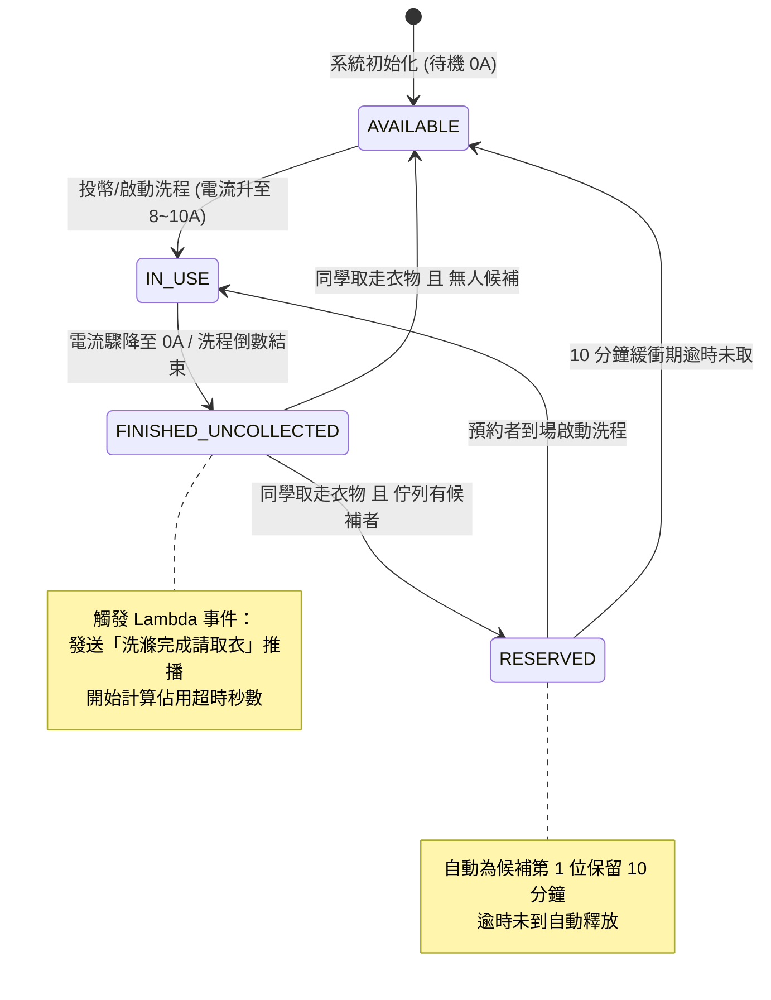

# 智慧校園宿舍洗衣機即時狀態監控與預約流 (Smart Dorm Laundry IoT System)

> **課程專案**：雲端運算運用與實務 期中專案 MVP  
> **核心架構**：雲端原生 (Cloud-Native) · 事件驅動 (Event-Driven) · IoT 邊緣感測 (Edge Telemetry) · 輕量即時同步 (WebSocket & State Machine)

---

## 專案亮點與雲端架構映射 (Cloud Mapping)

本專案針對大學校園宿舍「**洗衣機佔用不知何時洗完**」、「**洗完衣服久未取出霸佔機台**」以及「**現場苦等缺乏預約公平性**」等痛點，設計一套具備雲端原生思維之 IoT 智慧管理系統。

### 雲端服務架構對應表 (供期中簡報引用)

| 系統層級 | 本專案實作 (Local MVP) | AWS 雲端原生映射服務 | GCP 雲端映射服務 | 架構設計核心考量 |
| :--- | :--- | :--- | :--- | :--- |
| **邊緣感測層** | `simulator.py` (4台機台虛擬傳感器) | AWS IoT Greengrass / ESP32 邊緣網關 | Cloud IoT Edge | 模擬電流 (安培 A) 與震動波動，支援斷線重試 |
| **數據攝入層** | FastAPI `/api/telemetry` | AWS IoT Core (MQTT / HTTP Ingestion) | Google Cloud Pub/Sub | 輕量高頻非阻塞數據收集，解耦邊緣與後端 |
| **事件匯流排** | `EventEngine` 事件路由器 | Amazon EventBridge | Google Cloud Eventarc | 事件驅動 (Event-Driven)，依據事件模式解耦派送 |
| **無伺服運算** | Python Async 狀態機引擎 | AWS Lambda + AWS Step Functions | Cloud Functions + Cloud Run | 無伺服器自動縮放，按事件執行狀態判定與計時 |
| **資料儲存層** | SQLite (`laundry.db`) | Amazon DynamoDB (狀態) + Timestream (時序) | Cloud Firestore + Bigtable | 時序日誌與分散式狀態機持久化 |
| **雙向即時通訊** | WebSocket (`/ws`) 廣播管理器 | Amazon API Gateway (WebSocket API) | Firebase Realtime Database | 毫秒級即時狀態推播，避免前端大量輪詢 (Polling) |
| **外部推播服務** | Dispatcher (Webhook / Console) | Amazon SNS / LINE Notify Webhook | Firebase Cloud Messaging (FCM) | 洗滌結束 10 分鐘取衣警報、輪替候補推播通知 |

---

## 狀態機生命週期圖 (State Machine Flow)

系統中每台洗衣機/烘衣機皆遵循嚴格的事件驅動狀態機生命週期：



---

## 專案檔案結構

```text
smart-laundry-iot/
├── app.py                # FastAPI 核心伺服器、WebSocket 廣播與 RESTful API
├── database.py           # SQLite 關聯資料庫 Schema 定義與初始資料填充
├── event_engine.py       # 事件驅動核心邏輯 (模擬 EventBridge + Lambda Worker)
├── simulator.py          # IoT 邊緣感測器獨立模擬器 (多線程發送電流/震動)
├── requirements.txt      # 專案相依套件清單
├── laundry.db            # 自動生成之 SQLite 資料庫檔案
├── templates/
│   └── index.html        # 響應式現代前端儀表板 (TailwindCSS + WebSocket Live Sync)
└── README.md             # 期中評分架構說明書與操作手冊
```

---

## 快速啟動指引 (Quick Start)

### 步驟 1：安裝環境相依套件
在專案根目錄下執行：
```bash
pip install -r requirements.txt
```

### 步驟 2：啟動雲端後端伺服器 (FastAPI + WebSocket)
```bash
python app.py
```
- 伺服器啟動於：`http://127.0.0.1:8000`
- 自動開啟 Swagger API 文件：`http://127.0.0.1:8000/docs`
- 打開瀏覽器訪問首頁即可看到即時儀表板！

### 步驟 3：在第二個終端機啟動 IoT 邊緣模擬器 (選用)
```bash
python simulator.py
```
- 模擬器每 3 秒自動向後端發送 4 台機器的即時傳感器遙測數值（電流與震動等級）。
- 同時支援互動式鍵盤操作（如輸入 `1` 即可模擬機台運轉）。

---

## 課堂展示 (Demo) 評分通關操作流程

在向教授簡報或 Demo 時，可透過網頁前端下方的**「現場課堂快速 Demo 控制面板」**進行流暢展示：

1. **展示「正常運轉」**：
   - 點擊「**機台1: 30秒極速洗程**」。
   - 觀察：機台卡片即時變成藍色 `IN_USE`，倒數計時開始，電流儀表跳至 ~8.8A，下方事件匯流排即刻印出 `[API_Gateway] CYCLE_STARTED`。
2. **展示「排隊候補機制」**：
   - 點擊「**機台1: 模擬同學登記排隊**」，輸入姓名（如：陳同學）與信箱。
   - 觀察：卡片右下角顯示「1 人等待中」。
3. **展示「事件驅動洗滌完成」**：
   - 點擊「**機台1: 電流驟降洗程結束**」或靜待 30 秒倒數結束。
   - 觀察：後端自動判定電流驟降，機台變成橘黃色 `FINISHED_UNCOLLECTED` 警告燈，並即刻觸發雲端取衣推播事件。
4. **展示「智慧交接與 10 分鐘防霸佔保護期」**：
   - 點擊「**機台1: 取出衣物 & 自動保留**」。
   - 觀察：系統檢測到候補佇列，**不會直接變成閒置**，而是自動轉移成紫色 `RESERVED` 保留給剛剛登記的陳同學，並開始倒數 10 分鐘緩衝期！
5. **展示「雲端架構說明彈窗」**：
   - 點擊導覽列右上角「**雲端架構說明**」按鈕，直接向教授解說 AWS / GCP 雲端服務映射關係。
